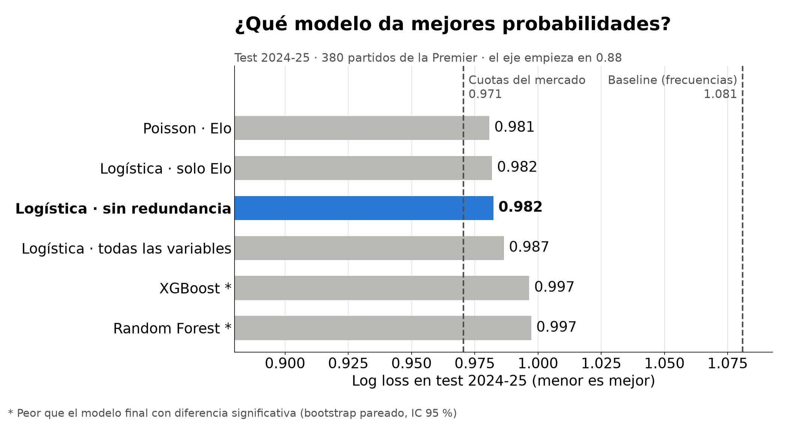
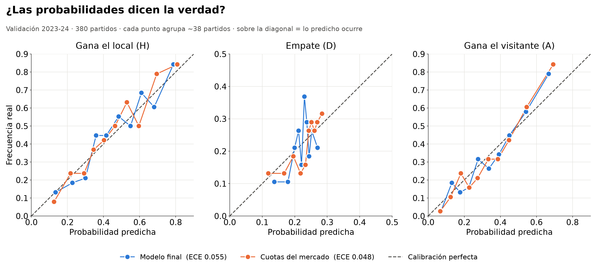
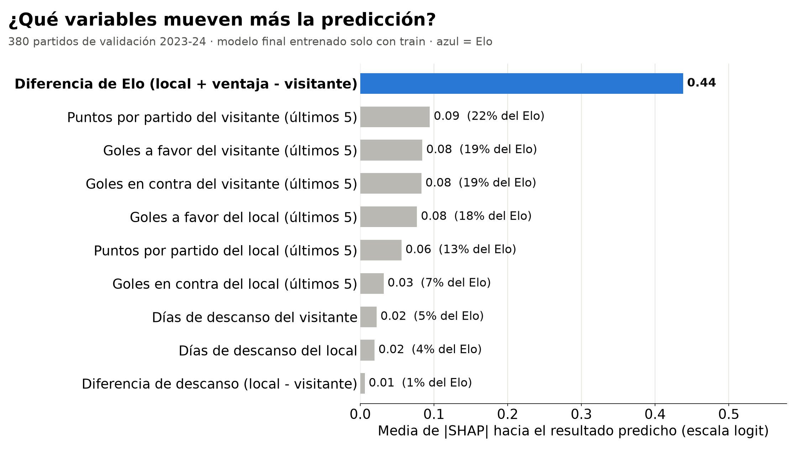
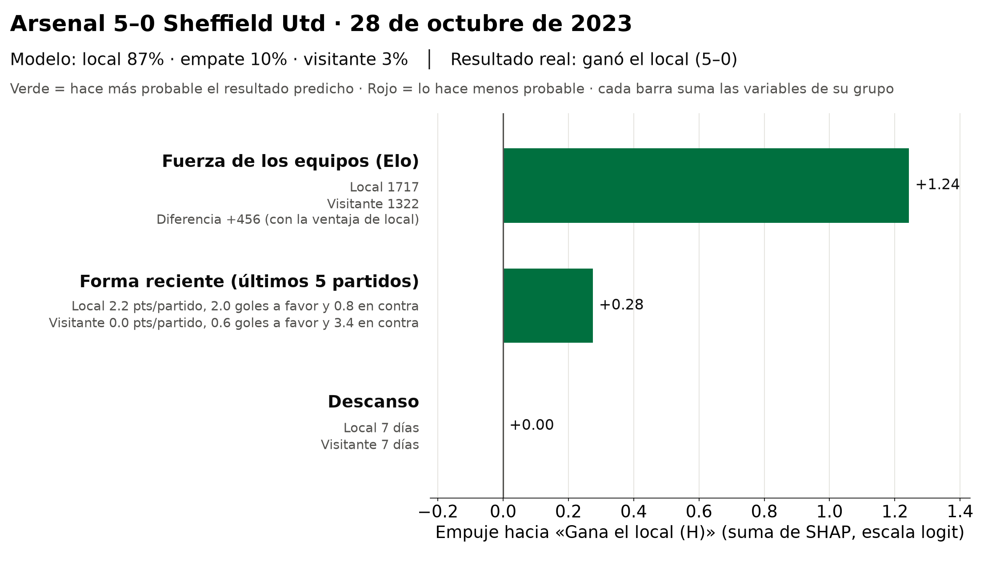

# Predicción de resultados de fútbol con Machine Learning

**En pocas palabras:** estimamos la probabilidad de que en un partido de la Premier League gane el
local, haya empate o gane el visitante, usando solo lo que se sabe *antes* del partido (fuerza de
cada equipo, forma reciente y días de descanso). En la temporada de prueba 2024-25 nuestro modelo
final recorre el **89 % del camino** entre adivinar con las frecuencias históricas y las
probabilidades de las casas de apuestas, y su diferencia con las casas **no es estadísticamente
significativa**.

> Herramienta educativa y analítica. No es un consejo para apostar.

## Cómo evaluamos al modelo de forma honesta

1. **Entrenamiento (2017-18 a 2022-23):** aquí aprenden los modelos. Los hiperparámetros se
   ajustan con validación cruzada temporal (`TimeSeriesSplit`): siempre se entrena con el pasado y
   se evalúa con el futuro.
2. **Validación (2023-24):** aquí comparamos todos los modelos y elegimos uno.
3. **Decisión registrada antes de ver el test:** el 18 de octubre de 2026 elegimos como modelo
   final la regresión logística `logistica_sin_redundancia` y lo dejamos escrito en
   [`CLAUDE.md`](CLAUDE.md#decisiones), con la regla de no cambiarlo después.
4. **Prueba o test (2024-25), una sola vez:** el 22 de octubre se evaluaron todos los modelos en la
   temporada 2024-25, que nunca se había usado (antes de esa corrida se reentrenaron con
   2017-18 a 2023-24). Los resultados quedaron congelados en `docs/` y el modelo final no se tocó.

Además, ninguna variable usa información del propio partido ni de partidos posteriores (lo
comprueba `tests/test_leakage.py`), y las cuotas de las casas solo se usan como referencia de
comparación, nunca como dato de entrada del modelo.

## Datos

Premier League 2017-18 a 2024-25 (8 temporadas, 3 040 partidos), de
[football-data.co.uk](https://www.football-data.co.uk/).

| Conjunto | Temporadas | Uso |
|---|---|---|
| Entrenamiento | 2017-18 a 2022-23 | Ajuste de modelos (`TimeSeriesSplit` para hiperparámetros) |
| Validación | 2023-24 | Comparación y elección del modelo final |
| Prueba | 2024-25 | Resultado final, evaluado una sola vez |

Variables del modelo final: diferencia de **Elo** (un puntaje de fuerza que sube al ganar y baja al
perder, con 60 puntos extra para el local), **forma** de los últimos 5 partidos (puntos, goles a
favor y en contra de cada equipo) y **días de descanso** de cada equipo.

## Resultados en el test (2024-25, 380 partidos)

La métrica principal es el **log loss**: mide qué tan buenas son las probabilidades y castiga
mucho estar muy seguro y equivocarse. **Menor es mejor.** El **% del camino** pone cada modelo en
una escala fácil de leer: 0 % = tan bueno como adivinar con las frecuencias históricas (baseline);
100 % = tan bueno como las cuotas de las casas de apuestas. La validación va al lado solo como
referencia.

| Modelo | Log loss test | Brier test | Accuracy test | **% del camino (test)** | ¿Distinto del modelo final en test? | Log loss validación | % del camino (validación) |
|---|---|---|---|---|---|---|---|
| Cuotas del mercado (referencia) | 0.971 | 0.579 | 54.2 % | 100 % | No (−0.012; IC −0.025 a +0.004) | 0.909 | 100 % |
| Poisson con Elo | 0.981 | 0.586 | 53.4 % | 90.8 % | No (−0.002) | 0.931 | 85.3 % |
| Logística · solo Elo | 0.982 | 0.586 | 53.7 % | 89.8 % | No (−0.001) | 0.932 | 84.4 % |
| **Logística · sin redundancia (modelo final)** | **0.982** | **0.588** | **52.4 %** | **89.3 %** | — | **0.926** | **88.6 %** |
| Logística · todas las variables | 0.987 | 0.590 | 52.6 % | 85.5 % | No (+0.004) | 0.928 | 87.2 % |
| XGBoost | 0.997 | 0.594 | 52.9 % | 76.5 % | **Sí, peor** (+0.014; IC +0.002 a +0.026) | 0.934 | 82.9 % |
| Random Forest | 0.997 | 0.594 | 53.2 % | 75.7 % | **Sí, peor** (+0.015; IC +0.003 a +0.027) | 0.941 | 78.0 % |
| Baseline (frecuencias históricas) | 1.081 | 0.655 | 40.8 % | 0 % | **Sí, peor** (+0.099; IC +0.059 a +0.136) | 1.054 | 0 % |

Fuentes: `docs/resultados_test.csv`, `docs/resultados_validacion.csv` y `docs/bootstrap_test.csv`.
La columna "¿Distinto…?" es la diferencia de log loss frente al modelo final con un **bootstrap
pareado** (1 000 remuestreos de los mismos 380 partidos, intervalo de confianza del 95 %): si el
intervalo incluye el 0, no podemos afirmar que la diferencia sea real.

Todos los modelos, incluidas las cuotas, empeoran de validación a test: 2024-25 fue una temporada
con más sorpresas. Por eso el "% del camino" es útil: el modelo final pasó de 88.6 % a 89.3 %, es
decir, no perdió terreno frente a las casas.

## Respuestas a las preguntas del proyecto

1. **¿Cuánto mejoran las variables (forma, Elo, descanso) frente a la frecuencia histórica?**
   Mucho y con seguridad: el log loss baja de 1.081 a 0.982 en test (diferencia de 0.099, con
   intervalo de confianza de 0.059 a 0.136, lejos del 0). La accuracy sube de 41 % a 52 %.
2. **¿Qué familia funciona mejor: lineal, árboles o Poisson?** Las lineales (regresión logística)
   y Poisson quedan prácticamente empatadas arriba (diferencias menores a 0.002, no
   significativas). Los árboles (Random Forest y XGBoost) son **significativamente peores** que el
   modelo final en test: con pocos datos y relaciones casi lineales, su flexibilidad extra no ayuda.
3. **¿Qué tan cerca llegamos de las casas de apuestas?** Muy cerca: 89 % del camino. Las cuotas
   siguen teniendo menor log loss (0.971 frente a 0.982), pero la diferencia **no es
   estadísticamente significativa** en test (el intervalo va de −0.025 a +0.004 e incluye el 0).
   Aun así, las cuotas ganan en el 94 % de los remuestreos, así que lo honesto es decir "muy
   cerca, pero sin superarlas".
4. **¿Qué variables pesan más?** La diferencia de **Elo**, con mucha distancia. Cada variable de
   forma pesa entre el 7 % y el 22 % de lo que pesa el Elo, y el descanso apenas un 1–5 %
   (valores SHAP, ver figura más abajo).

## Figuras

**Comparación de modelos en el test.** Los modelos lineales y Poisson quedan cerca de las cuotas;
los árboles (con asterisco) son significativamente peores que el modelo final.



**Calibración (validación 2023-24).** Cuando el modelo dice "60 %", el resultado ocurre más o
menos el 60 % de las veces, casi tan bien como las cuotas (error de calibración 0.055 frente a
0.048, dentro de lo esperable por azar con 380 partidos).



**Importancia de cada variable (SHAP global).** La diferencia de Elo es, por mucho, lo que más
mueve la predicción; la forma reciente ajusta y el descanso casi no influye.



**Explicación de un partido (SHAP agrupado).** En Arsenal 5–0 Sheffield Utd el modelo daba 87 % al
local, sobre todo por la enorme diferencia de Elo; la forma reciente lo reforzaba.



## Limitaciones

- **El azar pesa mucho y los empates casi no se pueden anticipar.** El modelo da probabilidad de
  empate en cada partido, pero nunca es la más alta: en test predijo 0 empates como resultado
  más probable, aunque hubo 93 (24 %). Es lo habitual en este problema: el empate rara vez es el
  resultado individual más probable.
- **No hay datos de lesiones, alineaciones, sanciones ni motivación.** El modelo solo sabe de
  resultados pasados y calendario.
- **Los datos llegan hasta la temporada 2024-25.** Los equipos de la demo son los de esa temporada
  y su Elo y forma son los de mayo de 2025 (último partido de la temporada), no los de hoy.
- **Muestras pequeñas:** cada temporada tiene 380 partidos, así que una diferencia de log loss puede
  ser casualidad. Por eso usamos bootstrap pareado antes de decir que un modelo es mejor que otro.
- La temporada 2020-21 se jugó sin público, lo que redujo la ventaja de local ese año.

## Cómo correr la demo en Windows

Requisitos: [Python 3.11](https://www.python.org/downloads/) y [Git](https://git-scm.com/). En
PowerShell:

```powershell
# 1. Clonar el repositorio
git clone https://github.com/amyra11/futbol-ml.git
cd futbol-ml

# 2. Crear y activar el entorno virtual
py -3.11 -m venv .venv
.venv\Scripts\activate
# Si PowerShell bloquea la activación, ejecuta antes:
#   Set-ExecutionPolicy -Scope Process -ExecutionPolicy Bypass

# 3. Instalar dependencias
pip install -r requirements.txt

# 4. Descargar y preparar los datos (solo este paso necesita internet)
python -m src.data.download      # CSV crudos en data\raw\
python -m src.data.clean         # data\processed\matches.csv
python -m src.features.build     # data\processed\features.csv

# 5. Entrenar y guardar el modelo final (models\modelo_final.joblib)
python -m src.models.final

# 6. Abrir la demo (se abre en el navegador, en http://localhost:8501)
streamlit run app/app.py
```

Para detener la app: `Ctrl + C` en la terminal. Una vez hechos los pasos 4 y 5, la demo funciona
sin internet. Para correr los tests: `python -m pytest -q`.

## Estructura del repositorio

- `src/data/` descarga y limpieza · `src/features/` Elo, forma y descanso
- `src/models/` baseline, logística, Random Forest, XGBoost, Poisson y modelo final
- `src/evaluation/` métricas, bootstrap, calibración, SHAP y la corrida única del test
- `app/app.py` demo en Streamlit · `docs/` resultados congelados, figuras y plan
- `notebooks/` exploración y análisis · `tests/` pruebas, incluidas las de fuga de datos

## Equipo

- **Amyra Loayza:** datos, variables (Elo, forma, descanso), modelo de Poisson y app de la demo.
- **Sebastián Granja:** modelos, evaluación, calibración e interpretabilidad (SHAP).
